# Sky Clock

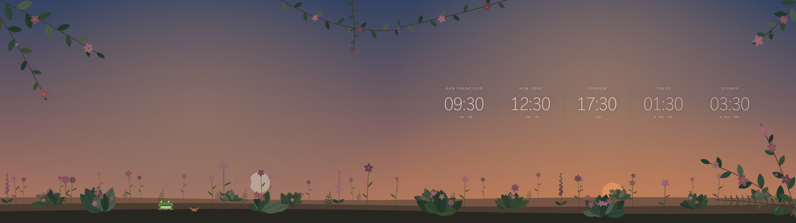

A quiet desktop background: a garden under the **real sky over your location**, with clocks for the cities you choose. It works on one, two or three monitors.

- **The sun and moon are where they really are**, with the moon's true phase, tilted so its lit side faces the sun.
- **Eclipses are real.** A solar eclipse covers the sun as much as it does at *your* location (parallax and all), the sky and clocks darken to twilight, the stars come out and a total eclipse shows the corona. A lunar eclipse slides Earth's shadow across the moon and turns it copper.
- **About 2,000 stars and the five naked-eye planets** (Mercury, Venus, Mars, Jupiter, Saturn) sit in their true places, wheeling overhead as the night goes on. Planets have a faint hue; stars are white.
- **You see the stars as through your own window.** Tell it which way the window faces and that direction sits in the middle of the screen.
- **Hover** over a planet to see its name, or over a constellation to see its figure and name. The figures are hidden otherwise.
- **Bright blue by day, very dark at night**, so your screens don't glare. Everything follows the sun's real height.
- **A garden on three hills**, one behind another: the far ones are smaller and fade into the sky's colour, so it has depth. A little frog sits in the grass, and there's a crab beside it.
- It ticks once a minute, so it costs next to nothing.

| | |
|---|---|
| 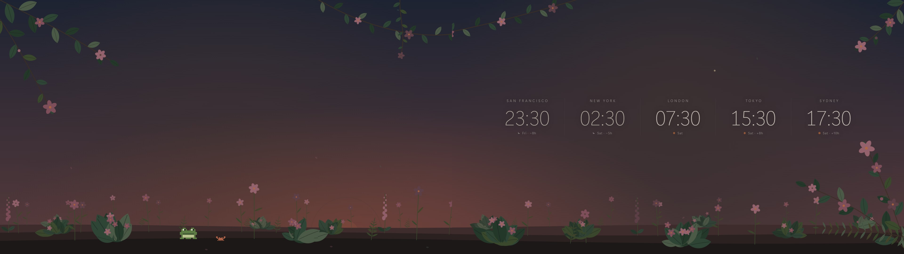 | 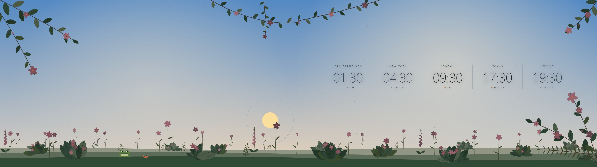 |
| 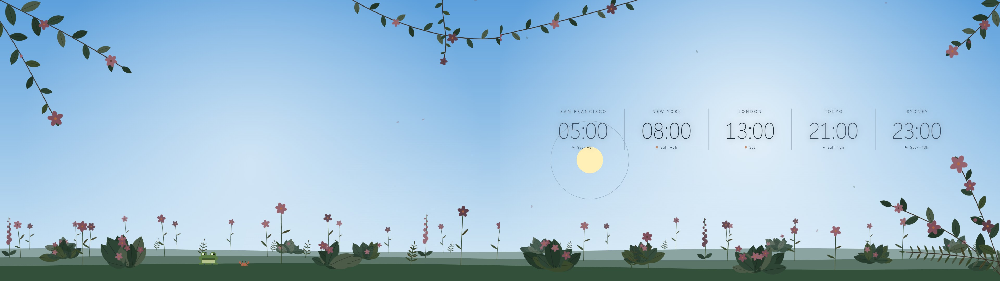 | 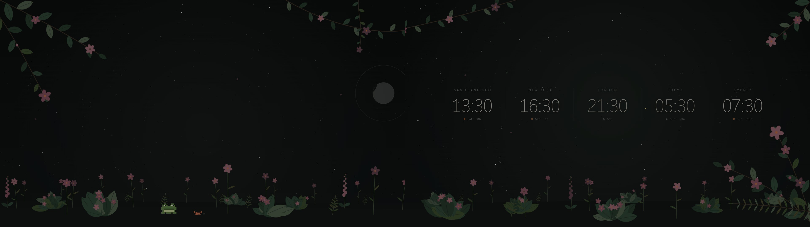 |
| 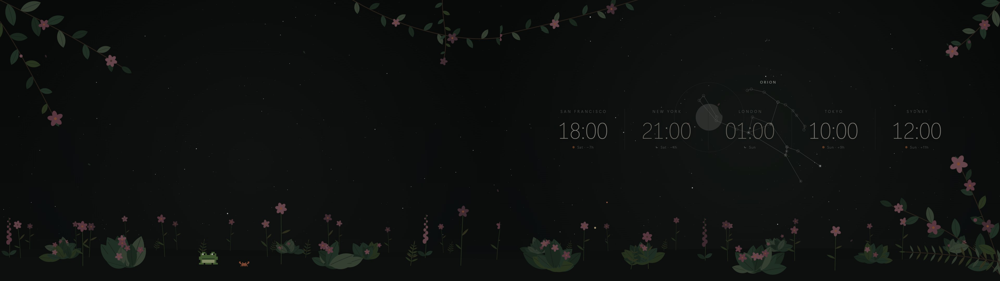 | 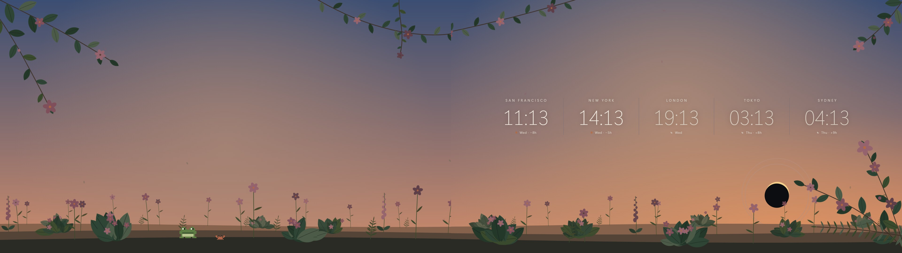 |
| 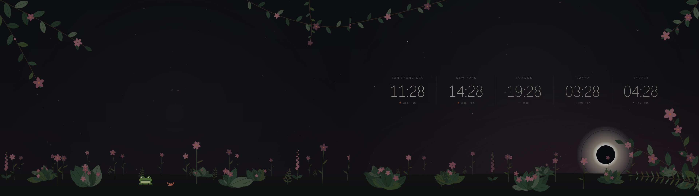 | 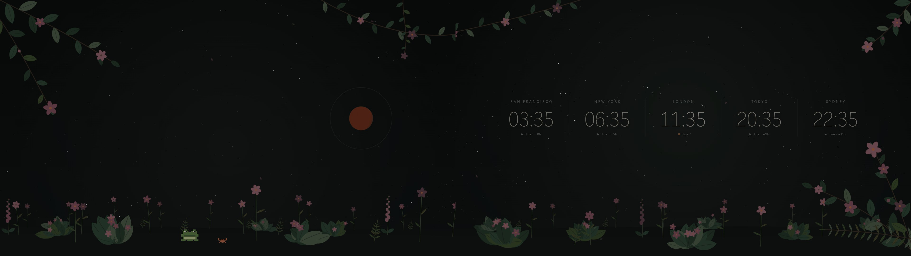 |

On three monitors:

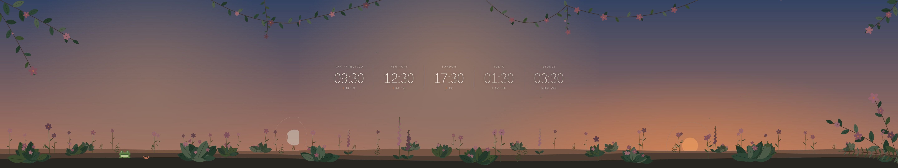

On one:

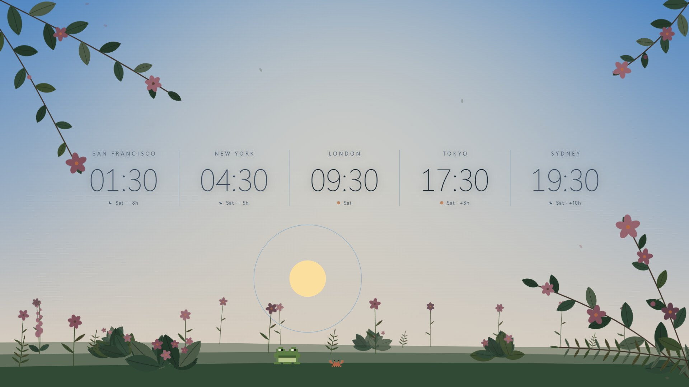

## Settings

Open **`config.js`** in any text editor. Every setting is explained there:

| Setting | What it is |
|---|---|
| `latitude`, `longitude` | Where you are, in decimal degrees. Approximate is fine. South and west are negative. |
| `window` | The way your window faces: a compass point (`'NE'`, `'SSW'`, `'E'` ...) or a bearing in degrees (`45`). |
| `monitors` | `1`, `2` or `3` monitors side by side, or `'auto'` (the default), which reads it from the shape of the window. The clocks sit on the second monitor, or the only one. |
| `bezel` | The gap between neighbouring monitors' screens, in pixels of a 1080p screen (default 50). The picture carries on behind it, so things line up across the gap; raise it if your monitors stand further apart. |
| `cities` | The clocks, left to right, at most 5: `{ name: 'Tokyo', timezone: 'Asia/Tokyo' }`. Timezone names are from the [tz database list](https://en.wikipedia.org/wiki/List_of_tz_database_time_zones). Give fewer and it shows fewer. |
| `order` | `'listed'` (the default) keeps the clocks as you wrote them. `'timezone'` sorts them west to east; cities in the same timezone stay in the order you listed them unless you give one a `nudge` (`nudge: -1` moves it left of its neighbours, `nudge: 1` right). |
| `home` | The timezone the `+3h` / `−8h` offsets are measured from. `'local'` is this computer's. |
| `frog`, `crab` | The little frog and the crab beside it. `true` or `false`. |
| `livelyPanel` | In Lively, the Customise panel has the same settings and takes priority. Set to `false` to use only `config.js`. |

## Using it

**In Lively Wallpaper** ([rocksdanister/lively](https://github.com/rocksdanister/lively)): drag this folder (or its `.zip`) onto the Lively window, choose it, then use the Customise panel (the sliders icon) for latitude, longitude, window direction, monitors, clocks and so on. For more than one monitor, set Lively's screen layout to **Span**. Mouse hover only works when Lively's wallpaper input is set to pass the mouse through, and only while the desktop is showing.

**In a browser:** open `index.html`. It uses `config.js` for settings. Handy for trying things out.

### Trying other places and times

Add these to the address in a browser:

| Add | Does |
|---|---|
| `?lat=-33.9&lon=151.2&dir=SSE` | Try another place and window direction |
| `?monitors=3` | Force one, two or three monitors (the window should be that many 16:9 screens wide) |
| `?bezel=80` | Try another gap between monitors |
| `?time=2026-10-24T16:30:00Z` | Show another moment (UTC) |
| `?time=2026-08-12T18:13:30Z` | The partial solar eclipse seen from London (91% covered) |
| `?time=2026-08-12T18:28:30Z&lat=42.34&lon=-3.70` | The total solar eclipse over Burgos, Spain |
| `?time=2026-03-03T11:35:00Z&lat=35.7&lon=139.7&dir=S` | The total lunar eclipse of 3 March 2026, seen from Tokyo |
| `?pick=Ori` or `?pick=Jupiter` | Show the hover for a constellation (three-letter id) or planet |
| `?sun=-30,0` / `?moon=25,100` | Put the sun or moon at an altitude and azimuth |

The screenshots in `screenshots/` were made with these.

## How it works, and what it fudges

- Positions use compact formulas: the sun to about 0.01°, the moon (the biggest 62 terms of the standard lunar series) to a few hundredths of a degree, and the planets to about a degree. That's enough to get eclipses to within a couple of minutes: it gets the 12 August 2026 eclipse right (totality over Burgos at 18:28 UTC) and the umbral magnitude of the March 2026 lunar eclipse to 1.16 against 1.15 published. Atmospheric refraction is ignored.
- **The sun and moon discs are drawn far bigger than the sky they sit in** (about 190 units a degree against 13), so an eclipse works on the discs' own scale: within a degree of the sun the moon is placed at exactly that scale and in the true direction, so contacts happen when they really do. Further out it eases back to its place on the sky, and hovers a little clear of the sun for a day or so either side of new moon so nothing jumps. The sun disc is the sun's true size relative to the moon's.
- A solar eclipse darkens the sky by treating the sun as lower than it is, in proportion to how dim the eye would find it (brightness is judged on a log scale: 90% covered is only slightly dim, 99% is twilight).
- **Stars and planets use a "window" projection**: your window's direction is in the centre, about 13 screen units to a degree, with the high sky squeezed a little sideways so it isn't stretched. Constellations are recognisable but not chart-perfect.
- **The sun and moon use a separate full-circle "panorama"** across all your monitors, so they're on screen whenever they're above the horizon, however your window faces. They travel left to right (clockwise). The panorama is cut where neither can be above the horizon (north in the northern hemisphere, south in the southern), so they never cross the join. Within about 29° of the equator they sometimes pass the cut, and slide off one edge and on at the other.
- The sun's and stars' x positions therefore don't line up with each other. That's deliberate.
- The fainter stars are real (they're the catalogue down to magnitude 5.2), but there's no Milky Way or deep-sky objects.

## Support

Sky Clock is free. If it brightens your desk, you can [buy me a coffee on Ko-fi](https://ko-fi.com/frodgepodge).

## Licence

MIT: see `LICENSE`. The star and constellation data come from the d3-celestial project (BSD 3-Clause), which draws on the Hipparcos catalogue, and planetary positions use the approximate orbital elements published by NASA/JPL: see `NOTICE.md`.
